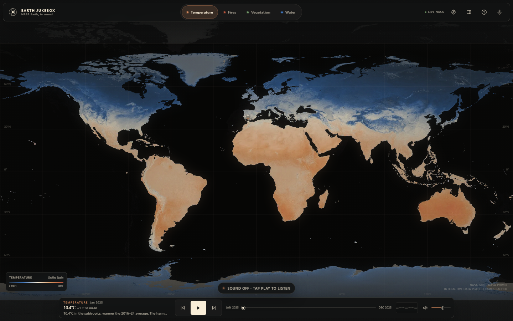

# Earth Jukebox

**NASA Earth, in sound.** A full-screen instrument for listening to satellite data. Choose heat, fire, leaf or water, then play the planet as it changes through time.

Earth Jukebox is built for a dark room, a pair of headphones and a keyboard. It is also built to be usable without sight: every data state has a spoken and visible description, the map is fully keyboard-operable, and the music is the interface rather than decoration.



## Quick start

No API keys and no network are required for the demo. NASA frames, series and hotspots are committed under `frontend/public/` and `backend/data/cache/`.

### 1. Backend

```bash
python -m venv .venv
# Windows: .venv\Scripts\activate
source .venv/bin/activate
pip install -r backend/requirements.txt

# from the repository root
python -m uvicorn main:app --app-dir backend --port 8000
```

The API is at `http://127.0.0.1:8000`; health check: `http://127.0.0.1:8000/api/health`.

### 2. Frontend

```bash
cd frontend
npm install
npm run dev
```

Open `http://127.0.0.1:5173`. Vite proxies `/api` to port 8000. Press **Play**, or press **Space**, to start audio after a user gesture.

For a production build:

```bash
cd frontend
npm run build
npm run preview
```

### Optional live data

Copy `.env.example` to `.env` only if you want live upstream requests:

```bash
cp .env.example .env
```

- `EARTH_JUKEBOX_LIVE=1` lets the Temperature track request a real monthly NASA POWER series first. Set `0` to stay on the prepared cache.
- `FIRMS_MAP_KEY` adds optional recent NASA FIRMS hotspots for `/api/hotspots` when a probe is placed. The key is read from the environment and never shipped to the browser.
- `ALLOWED_ORIGINS` controls CORS.

Every live path has a timeout and falls back to local data. A missing key, slow network or NASA outage cannot break the demo.

## What is on screen

- **Full-screen equirectangular map** with a per-track editorial colour treatment, place labels, graticule and probe marker.
- **Four tracks**: Temperature, Fires, Vegetation, Water. Each has its own palette, scale, tempo and instrument.
- **Transport**: play/pause, previous/next frame, volume, mute, timeline scrubber.
- **Live Now Playing** description, plus a mini waveform visualiser.
- **Probe panel** with value, anomaly, a sparkline, spoken description and a copyable listening link.
- **Explore mode**: move across the map to hear place values.
- **Guided story**: four chapters per track, 9 seconds each, with camera movement and narration.
- **Help, settings, share/export**: field guide, scale and intensity controls, contrast/motion/speech options, and a 20-second audio postcard recorded with `MediaRecorder`.
- **Cache badge**: `LIVE NASA`, `CACHED NASA`, or `LOCAL` when the map is running from bundled data.

## Sonification design

The map is analysed every frame on a 64 × 36 grid. The audio mapping is pure, bounded and deterministic (`frontend/src/audio/mappings.js`), then performed by a lazy-loaded Tone.js voice rack.

| Data feature | Musical parameter |
| --- | --- |
| Colour / hue | Pitch, quantised to the track's scale |
| Brightness | Filter opening and presence |
| Signal density | Notes per bar, percussion force, tempo |
| Contrast / edges | Reverb depth, detune, dry texture |
| Place on Earth | Stereo position and register |
| Anomaly | Harmony: minor for heat/loss, major for balance/recovery |
| Probe time series | Two-bar melodic phrase built from the local 8-value window |

| Track | Palette accent | Character |
| --- | --- | --- |
| Temperature | `#d98c5f` warm rust | Slow sine pad, FM arpeggio, Dorian; turns minor with heat anomalies |
| Fires | `#c1573d` ember | Phrygian percussion: pink-noise crackle, membrane impacts, ember ticks, dry air |
| Vegetation | `#739a69` leaf | Major pentatonic marimba plucks, soft bass, shaker texture |
| Water | `#3f75bb` blue | Minor pentatonic drones, slow filter sweep, wide ripple chords |

The master chain is gain → compressor → limiter (−2 dB) → analyser, with 60% default volume and smooth ramps. Audio only starts after a gesture.

## Data provenance

All imagery comes from **NASA GIBS**; temperature series come from **NASA POWER / MERRA-2**. The app never invents a data value. Frames are an editorial re-colouring of official GIBS pixels using the project palette (`#121313`, `#f9eed8`, `#3f75bb`, `#739a69`). Palette ranks recover relative signal, not physical units, for the derived tracks.

| Track | GIBS layer | Window | Series source |
| --- | --- | --- | --- |
| Temperature | `MODIS_Aqua_L3_Land_Surface_Temp_Monthly_Day` | Jan–Dec 2025 | NASA POWER T2M monthly (live, 2016–present) with cached 8×9 anchor grid fallback |
| Fires | `MODIS_Terra_Thermal_Anomalies_Day` | 15th of each month, 2025 | Palette-derived 0–100 heat index; aggregated thermal-anomaly hotspots (≤2,000 per frame) |
| Vegetation | `MODIS_Terra_L3_NDVI_Monthly` | Apr 2024–Mar 2025 | Palette-derived NDVI proxy, calibrated to 0–0.85 |
| Water | `GRACE_Tellus_Liquid_Water_Equivalent_Thickness_Mascon_CRI` | Aug 2021–Jul 2022 | Palette-derived water-storage anomaly, roughly −18 to +24 cm |

Important limits:

- **Water** is GRACE/GRACE-FO liquid water equivalent thickness, a coarse monthly mascon product. It is not groundwater level, soil moisture or a current drought index. The displayed window is 2021–2022.
- **Fires** are thermal anomalies from MODIS/Terra, aggregated to a 2.5° grid. The index is relative heat signal, not burned area or FRP.
- **Vegetation** is a palette-derived NDVI proxy. It tracks the official NDVI colour field, not a calibrated per-pixel NDVI retrieval.
- **Temperature** frames are monthly land-surface temperature. The time series is air temperature at 2 m from POWER; the two are related but not identical quantities.
- The globe is shown at 1:1 aspect on a stylised Blue Marble relief. There is no projection distortion correction or polar inset.

`scripts/prepare_data.py` regenerates everything from GIBS and POWER and writes `backend/data/cache/manifest.json` with source URLs, dates and layer names. Original downloaded PNGs are kept in `.cache/originals/` (ignored by git) for reproducibility.

## Offline and cache behaviour

Two independent caches make the demo robust:

1. **Bundled frontend cache** — `frontend/public/frames/` (48 WebP frames + basemap) and `frontend/public/data/` (grids, power grid, hotspots). The map, probe, sparkline and timeline work with no backend and no network.
2. **Backend cache** — `backend/data/cache/` plus an in-process TTL/LRU cache (`256` entries, `600 s`; upstream responses `900 s`). `/api/series` and `/api/hotspots` prefer live data when configured, then fall back to prepared NASA data.

If the backend is unreachable, the frontend switches to its local JSON and frames. The badge reads `LOCAL`; a live response reads `LIVE NASA`; prepared backend data reads `CACHED NASA`.

### API

| Endpoint | Purpose |
| --- | --- |
| `GET /api/health` | Service and cache status, live flags, layer list |
| `GET /api/layers` | Track metadata, dates, sources, units |
| `GET /api/series?layer=&lat=&lon=&cached=` | Monthly series, normalised values and anomaly |
| `GET /api/hotspots?layer=fires&date=&lat=&lon=` | Cached or optional live FIRMS anomalies |
| `GET /api/describe?layer=&lat=&lon=&date=` | Plain-language point description |
| `GET /api/cache/clear` | Hidden; only when `EARTH_JUKEBOX_ALLOW_CACHE_CLEAR=1` |

All endpoints validate layer names, coordinates and dates, and return a 503 with a preparation hint if the cache is missing.

## Accessibility

Accessibility is the default, not a mode.

- **Keyboard**: `Space` play/pause, `←/→` frame, `↑/↓` volume, `1–4` tracks, `P` probe, `E` explore, `M` mute, `S` story, `?` guide, `Esc` close. Space on a focused button activates that button; shortcuts pause while a panel or story owns the screen.
- **Screen readers**: `role="application"` map with arrow-key probe movement (5°, Shift for 15°), labelled controls, live-region announcements for track, frame, probe and story changes, focus trapped in drawers and returned on close.
- **Speech descriptions**: optional system-voice narration of Now Playing and probe states.
- **Visual access**: WCAG AA contrast in both themes, 40 px+ targets, strong focus rings, high-contrast mode with opaque panels.
- **Motion**: honours `prefers-reduced-motion` and a manual setting; no pulsing or animated shimmer when reduced.
- **Audio safety**: audio begins only after a gesture, at 60%, through a compressor and −2 dB limiter; every parameter is ramped.

## Performance

Initial production build (gzip):

| Asset | Size |
| --- | --- |
| App JS | 97.3 KB |
| Motion chunk | 44.8 KB |
| CSS | 7.2 KB |
| Tone.js (lazy) | 81.2 KB |

Tone.js is loaded on the first play gesture, not at startup. Map frames and local JSON are served as static assets; no WebGL or map-tile network dependency is required.

## Tests

```bash
cd frontend && npm test     # 6 sonification mapping tests
cd backend && python -m pytest   # 8 API contract tests
```

The mapping tests assert finite and bounded outputs for every track, determinism, pitch response to data, phrase length, MIDI conversion and invalid dates. The API tests cover health, layers, temperature series, the fire 0–100 index, hotspots, descriptions, unknown layers and coordinate validation.

## Project structure

```
backend/
  main.py               FastAPI app, CORS, GZip, cache fallbacks
  services/             datasets, TTL/LRU cache, optional live NASA calls
  data/cache/           prepared manifests, grids, hotspots, POWER grid
  tests/                API contract tests
frontend/
  src/app/              store and app shell
  src/audio/            mappings, voices, engine (Tone lazy-loaded)
  src/components/       map, player, probe, drawers, story, onboarding
  src/data/             tracks, local-data fallback, API client
  src/hooks/            audio, keyboard, frame analysis, announcer
  src/vision/           GIBS frame analysis and frame paths
  src/styles/           editorial design system
  public/frames/        48 cached NASA frames + basemap
  public/data/          offline grids, power grid, hotspots
scripts/prepare_data.py NASA GIBS + POWER preparation
docs/                   creative process, demo script, audio samples
```

## Documentation

- [Creative process](docs/creative-process.md)
- [Three-minute demo script](docs/demo-script.md)
- [Audio samples](docs/audio-samples/README.md)

## NASA Space Apps submission

Earth Jukebox turns NASA Earth observation data into a playable instrument. A full-screen map of temperature, fire, vegetation or water is analysed frame by frame; colour becomes pitch, density becomes rhythm and anomaly becomes harmony. Blind and low-vision listeners get the same information through sound, spoken descriptions and a fully keyboard-operable map. Every frame, series and hotspot is cached locally, so the instrument works offline and degrades gracefully when NASA services are slow. Built with React, Tone.js, FastAPI and NASA GIBS/POWER/FIRMS data.

## License and credits

Code: MIT. Data: NASA GIBS, NASA POWER, NASA FIRMS, GRACE Tellus. Imagery is stylised for presentation; source layer names and dates are preserved in `backend/data/cache/manifest.json`.
